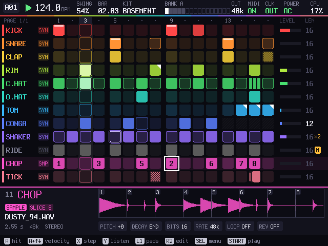
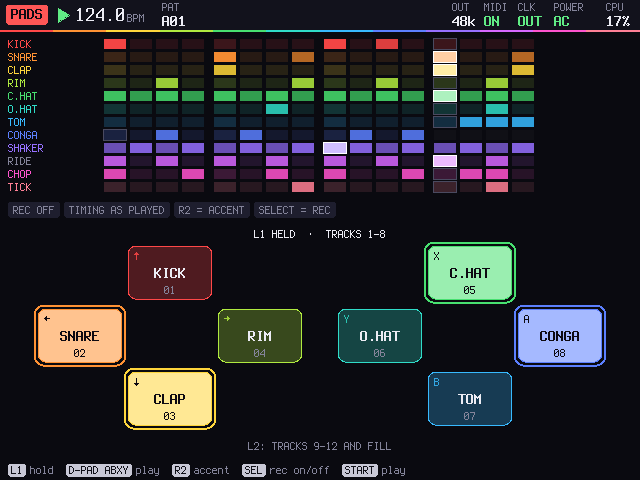
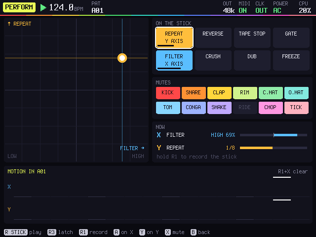
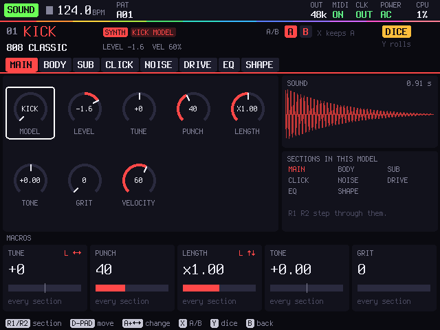
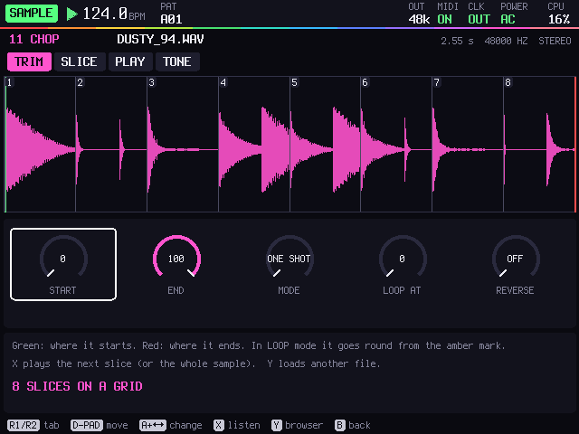

# RHYTHM

A drum machine and sampler for the R36S, the handheld game console that costs about $40.



**[Download for R36S](https://github.com/willbearfruits/r36s-rhythm/releases/latest)** ·
[Project page](https://willbearfruits.github.io/r36s-rhythm/) · [Get one](#get-one)

Twelve tracks of drums, built from scratch or chopped from samples, programmed step by step with the D-pad and played
live on the buttons. Hold a shoulder button and the face buttons become pads; push the right stick and the whole beat
goes through a stutter, a filter or a tape stop. It saves by itself a few seconds after every change, so you can switch
it off whenever you like.

## What it does

- **Twelve tracks, two kinds of sound.** Each track is a synthesized drum or a sample. The drums start from 58 factory
  sounds (kicks, snares, claps, rims, hats, toms, percussion), and every part of them is a knob: body, sub, click,
  noise, struck modes, 808 metal, clap bursts, drive, EQ, shape. Samples are your own WAV files, cut into up to 32
  slices on a grid or at their hits.
- **Patterns.** 128 of them, up to 64 steps each. A step has its velocity, nudge, ratchets (up to eight hits, flat,
  fading or rising), chance, a condition (1:2, 3:4, fill, first...), accent and flam. Each track has its own length and
  speed, so a 12-step conga can run against a 16-step kick. Swing per pattern.
- **Pads.** Hold L1 and the D-pad and A B X Y play tracks 1 to 8; hold L2 for tracks 9 to 12 and a fill. Turn REC on
  and what you play goes into the pattern where you played it.
- **Two sticks.** The left stick bends the selected drum (tune and length, at first) and, with A held on a step, locks
  the bend onto that step. The right stick plays two of eight effects from any screen: repeat, reverse, tape stop,
  gate, filter, crush, dub and freeze. Hold R1 on PERFORM and it records the stick into the pattern.
- **Generate.** Euclidean rhythms per track; dice that vary the steps and sounds of the tracks you don't keep; fills
  (roll, build, break, drop) that play when you hold FILL.
- **Sampling and rendering.** Record the master or one track, half a bar to eight bars, and put the take back on a
  track, sliced. Render a pattern or the whole song to a WAV file.
- **Song, mixer, effects.** A song of up to 128 entries, each with its repeats, tempo, mutes and last bar. A mixer with
  drive, sends, pan and level on every track. A tape delay modelled on PT2399 pedals, a reverb, and a master with a
  compressor, drive, a limiter and an output stage that can take the rate and bits down.
- **MIDI and sync.** Notes, clock, start and stop in and out, MIDI learn, program change picks the pattern, and a
  monitor of everything. Or a sync pulse on the headphone jack's left side for Pocket Operators, volcas and modular
  gear, with the beat in mono on the right.

| | |
|---|---|
|  |  |
|  |  |

## Get one

RHYTHM is software, so there is nothing to order. You need:

- an **R36S** with **ArkOS** on its SD card,
- a computer with a **card reader**, to copy RHYTHM and your samples onto the card,
- headphones, or a cable from the jack to a mixer; for sync, a Pocket Operator, a volca or a modular clock input;
  optionally a **USB MIDI** keyboard or controller (see [Status](#status)).

No R36S? It runs on a Linux computer too: [Run it on a computer](#run-it-on-a-computer).

## Install on the R36S

1. Download [`r36s-rhythm-port.zip`](https://github.com/willbearfruits/r36s-rhythm/releases/latest/download/r36s-rhythm-port.zip)
   (under 1 MB).
2. Turn the R36S off and put its SD card in the computer. Open the **EASYROMS** partition and the **ports** folder in
   it. (On an R36S with two cards, the games may be on the second card.)
3. Copy `Rhythm.sh` and the `rhythm` folder from the zip into `ports`, so you have `ports/Rhythm.sh` and
   `ports/rhythm/rhythm`.
4. Put the card back and turn the R36S on: **Ports > Rhythm**. It starts on the PATTERN screen with a beat loaded:
   press START.

To leave, hold SELECT + START for a second and a half.

Your samples go in `ports/rhythm/card/SAMPLES` (folders inside are fine; the folder appears after the first start, or
make it yourself): WAV files, 8 to 32 bit, any rate, mono or stereo. Projects are saved in `card/PROJECTS`, renders in
`card/RENDERS`, sampled takes in `card/RECORDINGS`. A newer version unzips over this one the same way, and the `card`
folder keeps your work. If something goes wrong, `rhythm/log.txt` and `rhythm/stdout.txt` say what happened.

When PortMaster is installed, RHYTHM uses its controller mapping; without it, it reads the R36S's buttons itself.

**Start it at power-on** (optional, needs a Linux computer and this repository): with the card's root partition
mounted, and RHYTHM in the first card's `ports` folder,

```
sudo tools/port/boot-into-rhythm.sh /run/media/$USER/root           # RHYTHM before the games menu, once per boot
sudo tools/port/boot-into-rhythm.sh /run/media/$USER/root --undo    # back to the games menu
```

It adds one marked block to ArkOS's start script and keeps the original next to it. Leaving RHYTHM goes on to the
games as before.

## Run it on a computer

On Linux, with a C compiler and the SDL2 and ALSA development packages (Debian and Ubuntu:
`sudo apt install build-essential libsdl2-dev libasound2-dev`):

```
git clone https://github.com/willbearfruits/r36s-rhythm
cd r36s-rhythm
make run
```

It opens a window at twice the R36S's size. The keys sit where the R36S's buttons do:

| R36S | keyboard |
|---|---|
| D-pad | arrow keys |
| A B X Y | `X` `Z` `S` `A` |
| L1 L2, R1 R2 | `Q` `W`, `O` `P` |
| START, SELECT | `Enter`, `Backspace` or right `Shift` |
| left stick, right stick | `I` `J` `K` `L`, numpad `8` `4` `5` `6` |

`F11` is full screen and `Esc` quits. A game controller works by position too (on an Xbox-style pad, bottom is B,
right is A, left is Y, top is X), and its stick clicks are L3 and R3, which the keyboard doesn't have. Files live in
`build/card` (or wherever `CARD` points). MIDI shows up as two ALSA ports, `rhythm in` and `rhythm out`: RHYTHM
listens to every device it finds and plays out to the hardware ones; a DAW subscribes to `rhythm out`.

## Controls

| Button | What it does |
|---|---|
| START | play and stop |
| SELECT | the menu of all sixteen screens. Held with the D-pad, it jumps: ← PATTERN, ↑ MIXER, → SOUND, ↓ PERFORM |
| D-pad | move. With A held, change the value under the cursor (←→ fine, ↑↓ coarse) |
| A | set a step; press a lit one to clear it. On a track's name: mute. Elsewhere: choose |
| B | back. On a track's name: solo |
| X | the step's details: velocity, nudge, ratchet, chance, condition, note or slice, accent, flam. On the names: GENERATE |
| Y | listen to the track. Y with ←→: the next or previous factory drum |
| hold L1, L2 | the pads: tracks 1 to 8, or 9 to 12 and FILL. SELECT in the pads turns recording on and off; R2 makes an accent |
| hold R2 | edit: A copies the row, X pastes, Y clears it, B undoes, ←→ turns the page, ↑↓ changes the pattern |
| hold R1 | on PERFORM: record the right stick into the pattern |
| left stick | two of the selected drum's settings, live (SETTINGS chooses which); with A held on a step, locked into it |
| right stick | two performance effects, one on each axis (PERFORM chooses which); R3 holds them where they are |
| SELECT + START, held | leave |

Every screen shows its buttons along the bottom, and SETTINGS > BUTTON MAP draws them all on the device.

## The screens

| Screen | |
|---|---|
| **PATTERN** | twelve tracks by sixteen steps, pages for longer patterns, and the selected track's sound underneath |
| **PATTERNS** | the sixteen patterns of a bank, eight banks: queue the next, jump now, copy, paste, clear |
| **SONG** | the chain of patterns: repeats, tempo, mutes, what the last bar does (as is, fill, drop) and what follows (go on, loop, stop) |
| **PERFORM** | which effects the right stick plays, track mutes, the stick's motion recorded in the pattern |
| **KIT** | the twelve sounds at a glance: name, engine, level, pan, choke group, MIDI. Kits save and load |
| **SOUND** | the drum engine one section at a time, every value a knob; X keeps an A and a B to compare, Y rolls dice |
| **SAMPLE** | a sample track's start and end, mode (one shot, gate, loop), reverse, slices, pitch, envelope, filter, drive, bits and rate |
| **SAMPLING** | records the master or one track and puts the take on a track |
| **MIXER** | twelve strips and the master |
| **FX** | the tape delay (synced or free, repeats, wobble, dirt, ping-pong), the reverb (size, decay, freeze) and each track's sends |
| **MASTER** | compressor, low and high cut, drive (warm, tape, fold), width, output rate and bits, limiter; a spectrum and a scope |
| **BROWSER** | samples on the card, the factory drums, kits and projects. It plays what the cursor rests on; A loads it |
| **PROJECT** | save, save as, open, new; render the pattern (once to eight times) or the song to WAV |
| **MIDI** | what goes in and out, each track's channel and note, MIDI learn, a monitor of every message |
| **SYNC** | where the clock comes from (internal, MIDI, auto), tap tempo, swing, and the headphone jack: stereo, sync pulse + mono, or tracks 1-6 left and 7-12 right |
| **SETTINGS** | drum quality, audio buffer, the sticks' dead zone, curve and settings, button repeat, A/B swap; the button map, diagnostics, how files get on the card |
| **GENERATE** | (X on the track names) Euclidean rhythms per track, dice and fills |

## Status

RHYTHM plays on the maker's R36S under ArkOS, and it is the first public version.

- The checks pass on a PC: 96 from a fresh clone, 212 with the reference renders from thump (see below), which compare
  each of the 58 drums against the engine they were ported from.
- The R36S has no audio input, so SAMPLING records what RHYTHM itself plays: the master or one track.
- Files go on and off the card with a card reader. Under ArkOS the card is in use, so the R36S can't act as a USB drive.
- MIDI goes through Linux's ALSA, on a PC and on the R36S alike. USB MIDI devices on the R36S are not confirmed yet.
- The battery level isn't read on the R36S yet: the corner of the screen says AC.
- Projects are the document saved as it is in memory: a later version that changes it may not open older projects.
- The core is written to build without an operating system too, for a version that starts straight into the
  instrument and lets the card be a USB drive. That version is not here yet.

## How it is built

The instrument is `core/`: plain C11 with no C library underneath (`lib.h` has its own maths, so every platform gets
the same numbers). Two halves meet only in `core/link.c`, two lock-free message rings and a status block:

- **the screen side** (`ui*.c`, `scr_*.c`) owns the document, takes buttons and sticks, and draws a 640 × 480 picture
  in the Terminus font;
- **the engine** (`eng.c`) keeps a copy of the document, patched across the link, and runs the sequencer
  sample-accurately at 48 kHz: the drums (`drum.c`, thump's engine in C, oversampled up to 4×), the sampler (`smp.c`),
  the effects and master (`fx.c`), the perform effects (`perf.c`), MIDI and the sync pulse. It can hand the twelve
  tracks to other cores.

The document (`doc.h`) is one plain struct with no pointers; a project file is that struct with a short header. What
a platform has to give the core is in `plat.h`: a clock, a log and files.

The hosts around it:

| | |
|---|---|
| `desktop/` | the instrument in a window (SDL2), sound through SDL, MIDI through ALSA, tracks on worker threads. Built for ARM64, it is also the R36S port |
| `test/check.c` | the checks: maths, the drums against thump, the sequencer's timing worked out by hand, the song, the perform effects |
| `test/host.c` | a headless host that runs the instrument from a script and writes screenshots and WAV files; the pictures here come from it |
| `test/render.c` | WAV files to listen to: every factory drum, the default pattern, thump's kits, and the bundled break |
| `test/bench.c` | how much of a core each part of the engine takes, part by part |

### Building

```
make            # build/host: check, render, rhythm-host, bench
make test       # the checks (one group alone: build/host/check drum)
make wavs       # build/out/*.wav
make run        # build/desktop/rhythm, in a window
make ref        # thump's reference renders, for the drum checks (needs thump's source in ~/Projects/thump; it isn't public)
```

The desktop build reads a few environment variables: `CARD` (where the card's files are), `RHYTHM_LOG`,
`RHYTHM_BUFFER` (audio frames), `RHYTHM_OS` (drum oversampling: 2 on ARM, 4 on a PC), `RHYTHM_WORKERS`,
`RHYTHM_POOL_MB` (sample memory, 256 MB).

### Building the port

The port is built in an ARM64 Debian buster container, so it links against a glibc older than ArkOS's. On an x86
computer, Docker needs qemu-user-static to run ARM64 containers.

```
docker build --platform linux/arm64 -t r36s-build:buster tools/port    # once
make port       # build/port/ and build/r36s-rhythm-port.zip, the release
make arm64      # the checks built for ARM64, to run on the R36S
```

`tools/port/` has the launcher (`Rhythm.sh`), the notes that go into the zip and `boot-into-rhythm.sh`.

### Layout

```
core/            the instrument: screen side, engine, drums, sampler, effects, fonts
desktop/         the SDL2 + ALSA host (PC and R36S)
test/            checks, headless host, renders, bench, the PC platform layer
tools/           mkfont.py (the fonts), port_presets.py and thump_ref.cpp (from thump), port/ (the ArkOS port)
docs/            the project page (index.html, img/) and mockups/, the screens as drawn before the code
```

The mockups in `docs/mockups/` are the design, drawn pixel for pixel before the code was written; the code follows
them, but a few (an FM page, the USB drive screen, the boot log) belong to versions that don't exist yet. The pictures
in `docs/img/` are the real thing, from `build/host/rhythm-host`.

## License

RHYTHM is free software: GPL-3.0-or-later ([LICENSE](LICENSE)). It draws with the Terminus font (SIL Open Font
License 1.1); [NOTICE.md](NOTICE.md) has the details.

---
Part of [Serious S.H.I.T.](https://willbearfruits.github.io/): instruments, tools and workshops made in Haifa by
Yaniv Schonfeld (Willbear). If this is useful to you, [support it on Patreon](https://www.patreon.com/Seriousshit).
